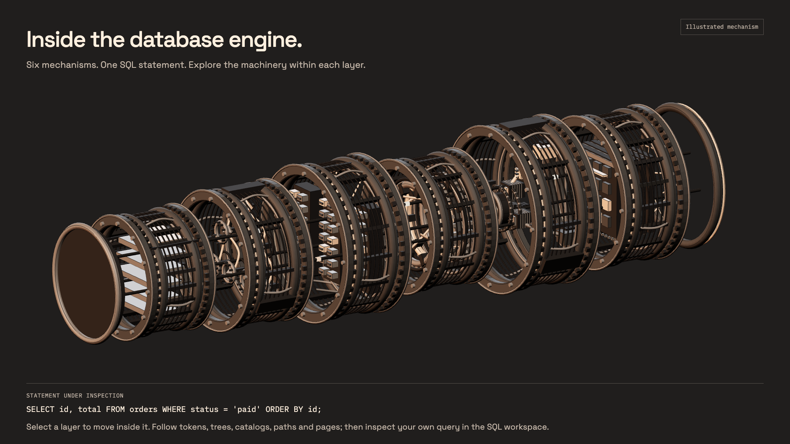
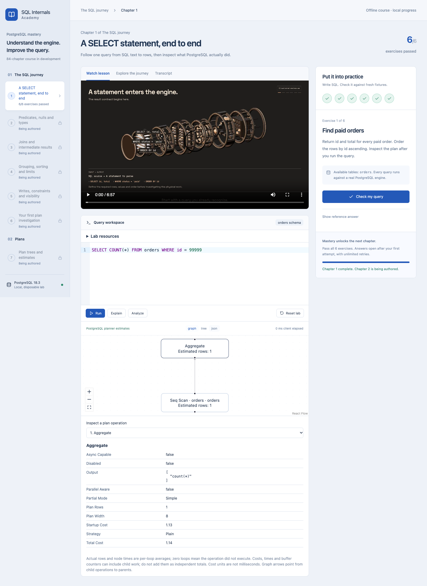

# insideSQL

**Understand the engine. Improve the query.**

Writing a query is only the beginning. The interesting part is what PostgreSQL does with it: the paths it considers, the rows it reads, the memory it uses, and the work it could have avoided.

insideSQL is a desktop course for people who already write basic SQL and want to get good at that part. Follow a statement through the engine, inspect a real execution plan, then write queries against a local PostgreSQL lab until they hold up across different datasets.



The machine is an illustration of the query's journey. The execution plans and query results come from real PostgreSQL. Keeping those two things clearly labelled matters.

## What a chapter feels like

Watch a narrated lesson with captions. Pause, replay, or step inside the parser, analyzer, rewriter, planner and executor. Then move to the SQL editor beside it.

Each chapter has six questions. You write the SQL yourself; the grader checks fresh fixture variants, including cases that the visible dataset might not reveal. A correct answer has to preserve the requested rows, duplicates, nulls and ordering. Write exercises also check the resulting database state.

Solutions start collapsed and locked. Your first nonempty, learner-written Run or Check unlocks the explanation—even a syntax error counts as an attempt. Passing all six questions completes a chapter; the next one becomes available once its lesson is published. Retries are unlimited, and scripts and progress stay on your machine.

<details>
<summary>See the workbench</summary>



</details>

## Where it stands

This is an early development build. The full course is still being made.

| As of October 11, 2026 | Available |
| --- | --- |
| Delivered chapters | **1 of 84**, with narrated video, captions and six working exercises |
| Authored chapters | **10**, containing **60 exercises**; chapters 2–10 remain unpublished |
| Remaining writing | 74 chapters and 444 exercises |
| Remaining chapter videos | 83 |
| Native verification | Apple Silicon macOS; current-build playback, SQL, grading and progress have been exercised |

The app already runs disposable PostgreSQL labs, saves drafts, cancels queries, grades across fresh variants, and separates `EXPLAIN` estimates from `EXPLAIN ANALYZE` measurements. The plan inspector has graph, tree and raw JSON views. Reset uses a durable journal, and measurement eligibility is tied to the actual lab generation. A second app instance cannot take over an owned workspace or stop its server.

The latest recorded checks pass: **64 Rust/PostgreSQL, 23 frontend and 11 browser checks**. That does not mean the course is finished. An intermittent missing plan arrow remains unresolved, stale server markers currently block reopening, and resource watchdogs and broader recovery still need work. The latest isolated native build succeeds; its GUI recheck was blocked by the Mac lock state.

The full [plan](docs/PLAN.md), dated [progress](docs/PROGRESS.md) and [review records](docs/reviews/) carry the details. Phase 1's external Claude review is pending source-transfer approval, so bulk video production has not started.

## Where the course is going

The curriculum begins with familiar SQL and follows it deeper into PostgreSQL:

- **SQL and plans:** predicates, joins, aggregation, writes, scans, loops, timing and buffers.
- **Storage and indexes:** heap pages, TOAST, visibility maps, B-trees, GIN, GiST, BRIN and index tradeoffs.
- **Query design:** sargability, subqueries, CTEs, windows, recursion, temporal queries and fanout-safe aggregates.
- **Planner and executor:** statistics, cardinality, costing, join search, rescans, memory, spills, parallelism and JIT.
- **Concurrency and durability:** MVCC, locks, deadlocks, vacuum, WAL, checkpoints, replication and recovery.
- **Production reasoning:** partitioning, observability, workload experiments and unfamiliar optimization incidents.

The target is 84 chapters with 504 required exercises. Planned fixtures span commerce, SaaS tenants, equity lifecycles, event analytics, search, hierarchies and financial ledgers. Commerce and orders variants are implemented; the other domains and larger workload profiles still need building. All data is synthetic.

## Under the hood

| Part | Built with |
| --- | --- |
| Desktop shell | Tauri 2 with a Rust application core |
| Database labs | App-managed PostgreSQL 18, Tokio, tokio-postgres |
| Local progress | SQLite through rusqlite |
| Workbench | React 19, TypeScript, Vite, CodeMirror, React Flow, TanStack Table, Radix |
| Engine scenes | Three.js, Theatre.js and Anime.js |
| Lessons and replay | Remotion and its player, local narration and timed captions |
| Checks | Rust integration tests, Vitest/Testing Library and Playwright |

Rust owns database lifecycle, credentials, restricted connections, assessment and progress. Learner SQL runs with limited privileges in disposable labs. The app does not attach to your existing PostgreSQL server. Animation and video share a frame clock so seeking restores the same scene.

## Run it locally

The supported development path today is **Apple Silicon macOS**. You need Node.js, Rust/Cargo, Python 3, Google Chrome, ffmpeg/ffprobe, macOS speech synthesis and the relocatable **Postgres.app PostgreSQL 18.3** runtime. Development used Node 24 and Rust 1.94.1; these are the tested versions, not a claim of minimum compatibility. Desktop builds also need the Xcode command-line tools.

```sh
git clone https://github.com/akhil-gautam/insideSQL.git
cd insideSQL
npm ci
npm run runtime:bundle
python3 scripts/narrate.py
npm run video:render
```

The bundling script copies `bin`, `lib` and `share` from `/Applications/Postgres.app/Contents/Versions/18`. It never connects to that installation's databases. Set `ACADEMY_POSTGRES_SOURCE` if the pinned runtime lives elsewhere.

Runtime binaries and generated lesson media are not committed. A fresh clone needs the steps above before it has a playable lesson or can package the desktop app. Narration and rendering currently produce chapter 1 only; rendering the full video takes time.

For the browser workbench, keep these running in separate terminals:

```sh
cargo run -p academy-core --bin preview
```

```sh
npm run dev
```

Open **http://127.0.0.1:1420**. The Rust bridge listens on loopback port 4318 and uses `.academy/preview` for its disposable data. `ACADEMY_HOME` and `ACADEMY_POSTGRES` can select a separate workspace and runtime.

For a desktop development session:

```sh
npm run tauri -- dev
```

Or build the local app bundle:

```sh
npm run tauri -- build --debug --bundles app
```

The bundle appears under `target/debug/bundle/macos/`, currently named `SQL Internals Academy.app`.

## Check a change

After bundling PostgreSQL:

```sh
ACADEMY_POSTGRES="$PWD/src-tauri/resources/postgres" cargo test -p academy-core -- --test-threads=1
npm test
npm run build
```

With the Rust bridge and Vite running, and Chrome installed:

```sh
npm run test:e2e
```

Database tests start real temporary PostgreSQL clusters and need local process, shared-memory and loopback permissions. The two ignored crash-worker tests are invoked explicitly by their parent tests. A browser pass is useful evidence; native WebKit playback and lifecycle still need their own checks.

## Working on insideSQL

[AGENTS.md](AGENTS.md) is the project guide. Start with [docs/PLAN.md](docs/PLAN.md) for scope, [docs/PROGRESS.md](docs/PROGRESS.md) for what has actually been verified, and [DESIGN.md](DESIGN.md) for the visual direction.

Good next contributions are concrete: a complete chapter with independently checked answers, a synthetic fixture that exposes a mistaken assumption, or a reproducible fix for an open runtime issue. Keep new chapters unpublished until their media and acceptance checks are ready. An outline is useful planning; it isn't a delivered lesson.

This is a local development artifact, not a signed public release. Distribution still needs platform packaging, dependency notices, Remotion eligibility and narration-rights clearance. Those records live in [docs/LICENSING.md](docs/LICENSING.md).
